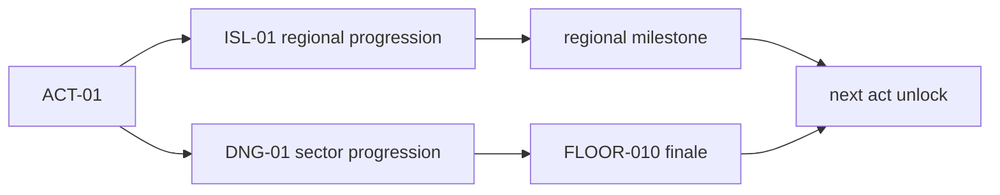

# World Progression Model Contract

Status: proposed
Contract owner: Project B, domain 06
Runtime status: not implemented
Release status: blocked
Date: 2026-07-22

## Purpose

This contract defines the product-level progression model for world and
dungeon content in domain `06`.

It is the semantic owner of:

- `ACT`
- `ISL`
- `DNG`
- `FLOOR`
- difficulty semantics
- world-path and dungeon-path parity

It does not define runtime adapters, balance numbers, loot numerics, or
plugin configuration.

## Canonical Vocabulary

| Term | Meaning |
| --- | --- |
| `ACT-xx` | progression bundle that groups one island and one dungeon sector |
| `ISL-xx` | regional world-space progression surface |
| `DNG-xx` | instanced dungeon sector progression surface |
| `FLOOR-xxx` | one sequentially unlocked floor inside a dungeon sector |
| `story` | onboarding and comprehension tier that preserves core mechanics |
| `standard` | reference progression tier and default encounter-design baseline |
| `veteran` | mastery-check tier for build stability and mechanic execution |
| `mythic` | repeatable endgame tier with expanded mechanics, not only numeric scaling |

Canonical IDs:

```yaml
act_id_pattern: ACT-[0-9][0-9]
island_id_pattern: ISL-[0-9][0-9]
dungeon_sector_id_pattern: DNG-[0-9][0-9]
floor_id_pattern: FLOOR-[0-9][0-9][0-9]
difficulty_ids:
  - story
  - standard
  - veteran
  - mythic
```

## Content Hierarchy

The canonical bundle shape is:

```text
ACT-01
├── ISL-01
└── DNG-01
    ├── FLOOR-001
    ├── FLOOR-002
    ├── ...
    └── FLOOR-010
```

Rules:

- Every `ACT-xx` owns exactly one paired `ISL-xx` and `DNG-xx`.
- `ISL-xx` is the open regional progression layer.
- `DNG-xx` is the instanced sector progression layer.
- `FLOOR-010` is the sector finale, but is not a raid by default.

## Difficulty Model

### Difficulty Roles

| Difficulty | Primary role | Guardrail |
| --- | --- | --- |
| `story` | understand floor layout, narrative, and baseline mechanics | cannot remove all core mechanics |
| `standard` | primary progression tier for most players | reference tier for encounter design |
| `veteran` | test mechanic mastery and build stability | must increase execution demands, not only numbers |
| `mythic` | repeatable endgame expression tier | must expand mechanics, not only HP or damage |

### Difficulty Rules

- `standard` is the canonical encounter-design baseline.
- `story` may reduce pressure, timing harshness, density, and punishment.
- `story` must preserve the mechanic language needed to learn the content.
- `veteran` and `mythic` may add behaviors, hazard combinations, objective
  pressure, and coordination checks.
- `mythic` cannot be the sole source of mandatory player power for a
  complete core build.
- Stat multipliers, enemy tuning, and power budgets are owned by domain `03`.

## Progression Model

World progression and dungeon progression are parallel, valid routes
through the same act structure.



Rules:

- A player may advance primarily through islands.
- A player may advance primarily through dungeon sectors.
- Doing both routes should broaden access to story, collections,
  cosmetics, and build options.
- Doing both routes should not create a mandatory higher core power
  ceiling than the main progression path.

### Progression Route Matrix

| Route | Primary activity | Can unlock next act | Should grant |
| --- | --- | --- | --- |
| world path | regional milestones and open-world escalation | yes | regional story access, collections, and regional rewards |
| dungeon path | sector progression through `FLOOR-010` | yes | dungeon rewards, replay materials, and encounter mastery path |
| combined path | both | yes | widest content coverage, not mandatory exclusive power |

## Island And Dungeon Parity Rules

### Islands

- Islands do not use a difficulty menu.
- Island difficulty comes from geography, escalation, faction pressure,
  and regional state.
- On initial access, `70-80%` of the island region should be available
  without mandatory campaign completion.
- `20-30%` of the island region may be gated by regional milestones.

### Dungeon Sectors

- Each dungeon sector contains `FLOOR-001` through `FLOOR-010`.
- Floors unlock sequentially inside the sector.
- Once unlocked, a floor remains selectable and repeatable.
- The sector should reuse and evolve a shared library of spaces, enemies,
  and mechanics across floors.

### Content Type Matrix

| Concept | World only | Dungeon only | Shared |
| --- | --- | --- | --- |
| open exploration | yes | no | no |
| sequential floors | no | yes | no |
| regional milestone gate | yes | no | no |
| difficulty variants | no menu | yes | semantic rules shared |
| reward identity | no | no | yes |
| mechanical language | no | no | yes |
| act unlock contribution | yes | yes | yes |

## Reward Path Guardrails

- Reward identity should stay coherent between paired `ISL-xx` and
  `DNG-xx`.
- Higher difficulty may improve reward quantity, category quality,
  cosmetic chance, collections, replay materials, prestige, and rankings.
- `mythic` must not be the only source of mandatory power progression.
- The main progression path must remain sufficient to complete a core
  build without regular `mythic` farming.

## Ownership Boundaries

This contract owns:

- progression semantics
- canonical ID semantics for `ACT`, `ISL`, `DNG`, and `FLOOR`
- content hierarchy semantics
- difficulty semantics
- world/dungeon parity rules

This contract does not own:

- unlock rule taxonomy and gating objects
- floor schema details
- act production status tracking
- travel node taxonomy
- stat multipliers or tuning
- runtime persistence or plugin adapters

## Contract Dependencies

This contract is upstream of:

- `docs/contracts/unlock-rules.yaml`
- `docs/contracts/dungeon-floor-contract.yaml`
- `docs/contracts/travel-and-discovery.md`
- `docs/contracts/island-sector-mapping.yaml`
- `docs/contracts/act-map.yaml`

## Migration Notes

Legacy difficulty names may exist in older design documents and future
adapter layers:

| Legacy name | Canonical replacement |
| --- | --- |
| `easy` / `latwy` | `story` |
| `normal` / `klasyczny` | `standard` |
| `hard` / `trudny` | `veteran` |
| `very_hard` / `bardzo_trudny` | `mythic` |

These are migration aliases, not proof of semantic equivalence in runtime
behavior.
