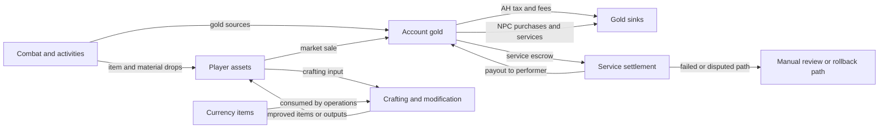

# Domain 10 Economy Model

## Purpose

This document is the governing economy model for Domain 10.
It defines the value-flow model, asset classes, money-supply policy, market
shape, sink strategy, NPC policy, and economy telemetry for MCMMORPG.

It is a design and contract document, not runtime proof and not a plugin
configuration file.

## Source Of Truth

Canonical authority:

- `docs/design/economy/economy-model.md` for the high-level economy model.
- `/home/przemek/.traycer/epics/b638c9da-033f-4f61-8587-60459f79e9b2/artifacts/domain-10-default-decisions/index.md`
  for the settled decision package behind this model.

Upstream dependencies:

- `docs/contracts/account-character-contract.yaml`
- `docs/contracts/account-character-model.md`
- `docs/contracts/character-scope-registry.yaml`
- `docs/design/items/itemization-framework.md`

This document does not replace future companion files such as:

- `docs/design/economy/currency-registry.yaml`
- `docs/design/economy/sources-and-sinks.yaml`
- `docs/design/economy/binding-policy.md`
- `docs/design/economy/escrow-contract.md`
- `docs/contracts/stack-lot-contract.yaml`
- `docs/design/economy/service-order-market.md`
- `docs/design/economy/marketplace.md`

Known upstream drift:

- `docs/contracts/economy-currency-contract.yaml` still contains a tentative
  primary-gold scope discussion.
- Domain 10 decision for v1 is now explicit: `gold` is `account-wide`.
- Any upstream contract that still marks primary gold scope as tentative should
  be aligned to this model, not treated as competing authority.

## Governing Intent

The economy must be:

- readable to players;
- stable under early and mid-population conditions;
- resistant to duplication, retry, restart, and double-payout failure modes;
- easy to audit and rebalance;
- supportive of item progression without letting the market fully own
  progression access;
- extensible toward richer systems later without requiring player wealth wipes.

The economy is not trying to be a pure sandbox simulation at v1.
It is intentionally controlled, legible, and biasing toward stability.

## Domain Boundary

Domain 10 owns:

- currencies and their allowed uses;
- gold sources and sinks;
- market rules;
- taxes and fees;
- escrow and service-settlement policy;
- bank, storage, and custody policy;
- economy telemetry and emergency lebalance levers.

Domain 10 does not own:

- crafting success chances;
- minigame parameters;
- item affix generation;
- salvage result tables;
- item power formulas;
- Service Order technical craft procedure internals.

Those belong to upstream domains, especially Domain 09 and Domain 05.
Domain 10 may regulate economy pressure only through cost, access, binding,
liquidity, taxes, custody, marketability, and sinks.

## Economy Goals

1. Keep `gold` meaningful from onboarding through endgame.
2. Let loot, crafting, and trade reinforce each other instead of bypassing each
   other.
3. Allow market play without allowing a small group to lock basic progression.
4. Create enough liquidity that useful items and materials move between players.
5. Remove currency continuously enough that inflation can be managed without
   emergency wipes.
6. Keep premium and economy-facing power systems cleanly separated.

## Asset Classes

| Asset class | Examples | Scope | Core use | Market policy |
| --- | --- | --- | --- | --- |
| Primary money | `gold` | `account-wide` | normal trade, services, NPC prices, taxes, escrow | broadly market-usable |
| Premium balance | IS / shop balance | `account-wide` | store and monetization surface only | not normal player-market money |
| Currency items | reroll orbs, upgrade catalysts, craft modifiers | item entity or durable stack | item modification, crafting, rerolls, upgrade gates | tradeable by explicit policy |
| Trade goods | ordinary materials, commodity drops | category-defined | gathering, crafting, resale | admitted only when the market eligibility matrix allows the surface |
| Progression goods | bottleneck mats, milestone tokens | category-defined | progression and gated systems | admitted or rejected by explicit matrix rows; unknown categories fail closed |
| Gear items | weapons, armor, relic-adjacent items | mostly `character-scoped` | combat progression | marketability depends on binding policy |
| Service contracts | `Service Order`, `RFO`, escrow claims | contract entity | player-to-player services | not traded like normal items |

### Important distinction: money vs currency items

`gold` is the primary money of the game.

`currency items` are not general money even if players treat them as valuable.
They work more like Path of Exile style economy instruments:

- they are consumed by item operations;
- they can be traded;
- they move through explicit stack or lot custody rather than raw balance math;
- they can become informal price references for high-end trade;
- they are not the universal mandatory unit for taxes, NPC prices, or standard
  market settlement.

This keeps a clear split between:

- the base economy money layer;
- item-modification resources;
- premium monetization value.

## Final Approved Economy Shape

### 1. Currency architecture

The approved v1 model is:

- `gold` as the main trading and service currency;
- a separate premium or IS balance;
- tradeable `currency items` used for item modification, rerolls, upgrades, and
  selected crafting operations.

Rules:

- premium balance must not become ordinary player-market tender;
- taxes and default service settlement are denominated in `gold`;
- service tender and customer-supplied operation fuel are distinct concepts;
- `currency items` may be listed, traded, stored, reserved, and escrowed only
  where later contract files explicitly allow that behavior;
- `currency items` use explicit stack-lot identity for reservation, split, merge,
  return, and partial settlement behavior;
- no system should force the whole economy to price ordinary goods only in
  premium balance or only in currency items.

### 2. Market shape

The approved `Auction House` model is global:

- one shared listing surface;
- one shared price-discovery surface;
- one shared fee logic for baseline AH behavior.

Regional or faction logic may later gate special categories, vendors, or access
rights, but it must not fragment the core v1 commodity and item market into
multiple incompatible AH economies.

### 3. Custody model

Approved custody split:

- all numeric currency balances are `account-wide`;
- most gear and item instances remain `character-scoped`;
- materials can use a separate shared `material bank` only when explicitly
  classified as storage-eligible.

Approved v1 authority:

- `gold` remains `account-wide` for v1;
- service, market, and refund flows must debit and credit the owning account
  even when initiated by one `character_id`;
- Domain 10 will not keep `gold` scope provisional while drafting marketplace
  and escrow rules.

This means the economy should feel convenient for ordinary trading without
turning every character on an account into a free item-transfer bypass.

## Value Flow Model

## Money Supply Model

### `gold` supply

`gold` enters the economy from controlled gameplay sources such as:

- onboarding and starter quest rewards;
- PvE activity rewards;
- dungeon and encounter rewards;
- selected repeatable systems that are explicitly budgeted as gold sources.

`gold` must not be created by:

- unrestricted vendor arbitrage;
- broad NPC floor-price guarantees;
- broken salvage loops;
- restart/retry duplication;
- direct premium-to-gold conversion in the standard economy.

### Premium supply

Premium value comes from monetization systems, not normal gameplay.
It is intentionally outside the ordinary player economy loop.

Premium systems must not become a hidden parallel economy for standard player
trade.

### Currency-item supply

`currency items` are generated as itemized or stackable resources from approved
gameplay sources.
They are part of the item economy, not the primary money supply.

Their durable custody model is stack-lot based:

- one listing or reservation may hold a whole stack lot or a partial lot;
- split and merge behavior must create traceable child or remainder lots;
- rollback must be able to return exact residual quantities, not only a vague
  equivalent amount.

They should be budgeted separately from `gold` because they affect:

- item progression velocity;
- modification throughput;
- high-end trade value;
- opportunity cost of crafting and rerolling.

## Sink Policy By Progression Stage

| Stage | Main sources | Main sinks | Design intent |
| --- | --- | --- | --- |
| Onboarding | starter quests, early PvE, tutorial rewards | travel, low NPC spend, first repairs, first listing fees | teach value without punishing experimentation |
| Early progression | region PvE, basic drops, simple trade | repairs, transport, basic service fees, storage expansion | establish gold circulation and first market habits |
| Mid progression | dungeons, broader trade, profession throughput | taxes, modification costs, material storage, service escrow fees | remove gold continuously while supporting specialization |
| Endgame | hard content, rare commodity trade, premium item-mod loops | expensive rerolls, high-tier services, prestige sinks, aspirational vanity | keep top-end wealth from compounding without bound |

### Sink structure

The model explicitly prefers many small and medium sinks over a single massive
sink.

Expected sink layers:

- micro sinks: listing fees, travel, repairs, small service charges;
- medium sinks: rerolls, modification costs, storage upgrades, convenience
  unlocks;
- large sinks: high-tier crafting and service costs, prestige, vanity, and
  aspirational status purchases.

## Role Of Player Archetypes

The economy should support at least three stable player roles:

### Gatherers

Gatherers supply raw market liquidity through:

- materials;
- commodity drops;
- low-processing trade goods.

Their play should create input for crafters and traders without forcing every
gathered asset into an NPC sell loop.

### Producers

Producers convert materials and currency items into improved market value via:

- crafting;
- rerolling;
- upgrade operations;
- item modification.

Their economic identity depends on margin, specialization, and access to
throughput, not on printing free value from zero-cost operations.

### Service providers

Service providers monetize skill, access, specialization, or trust through:

- `Fixed Price` jobs;
- `Request for Offers`;
- contract-backed item or material handling.

Their value is carried by trusted settlement and reputational throughput, not
just by raw item ownership.

## Relationship Between Drop, Crafting, And Trade

The model requires all three systems to coexist:

- drops provide discovery, baseline supply, and excitement;
- crafting and modification provide directed improvement and specialization;
- trade provides redistribution, price discovery, and liquidity.

None of the three should invalidate the others:

- drops must not make crafted progression irrelevant;
- crafting must not bypass the intended scarcity model entirely;
- trade must not make direct gameplay acquisition feel pointless.

`currency items` are the main bridge between item hunting and item improvement.
They let combat and gathering feed item progression without turning every
upgrade into a pure gold payment.

## Market Liquidity Policy

The market should stay liquid for useful assets while preserving control over
critical progression bottlenecks.

Approved liquidity rules:

- global AH for ordinary trade flow;
- direct trade permitted where binding and anti-fraud rules allow it;
- market access determined by asset class and binding policy, not by ad hoc UI
  exceptions;
- speculation allowed for some trade goods and convenience assets;
- speculation restricted for core progression bottlenecks and basic power
  access goods.

Liquidity is a goal, but unrestricted marketability is not.

## NPC Policy

NPCs are economy stabilizers, not the dominant market.

Approved NPC policy:

- NPC buy prices are stable and predictable;
- NPC sell-back prices are limited and generally low;
- NPCs should not be the best outlet for most player-generated market value;
- exceptions for onboarding smoothing or junk recovery must stay explicit and
  numerically conservative.

This keeps NPCs useful without turning them into infinite demand at healthy
prices.

## Binding And Marketability Policy

Binding is an economy-control tool, not only an item-security flag.

The economy model assumes future `binding-policy.md` will classify assets along
at least these axes:

- tradeable vs not tradeable;
- market-listable vs direct-trade-only;
- escrow-eligible vs not escrow-eligible;
- character-bound vs account-usable vs free-trade;
- service-output transferable vs service-output retained.

Economic design must prefer binding, custody, and market eligibility controls
over direct manipulation of crafting odds or loot math when the goal is market
stability.

## Services, Escrow, And Disputes

The approved service-economy stance is:

- service settlement uses explicit escrow;
- `RFO` does not fully reserve funds at publication time;
- full reserve occurs when a specific performer is chosen;
- refunds are for contract or execution failure, not ordinary weak RNG outcomes;
- ambiguous cases enter `manual_review`.

This preserves a clean boundary:

- Domain 09 owns whether an item roll was valid under the craft system;
- Domain 10 owns whether payment, custody, and settlement were economically
  correct.

## Inflation And Wealth-Concentration Metrics

The economy must track both inflation and concentration, not only total gold.

Minimum metrics:

- total `gold` in circulation;
- net `gold` created per day and per active character;
- net `gold` removed per day and per active character;
- median liquid `gold` by active account;
- p50, p90, p99 liquid `gold` by active account;
- top-1%, top-5%, and top-10% share of liquid `gold`;
- AH listing volume and completed-sale volume;
- price bands for key commodity groups;
- service market fill rate and timeout rate;
- currency-item generation, trade, and consumption rates.

### Inflation indicators

The system should treat these as warning signals:

- sustained growth of `gold` supply faster than active population growth;
- rising median commodity prices without equivalent sink pressure;
- widening spread between low-tier and high-tier material prices caused by
  source imbalance rather than legitimate scarcity;
- growing reliance on NPC sell loops instead of player trade.

### Concentration indicators

The system should treat these as warning signals:

- accelerating share of liquid `gold` controlled by top accounts;
- thin markets where a few actors dominate both supply and demand;
- routine progression materials becoming cornered by a small minority;
- high-end service throughput concentrating into too few providers with no
  competitive alternatives.

## Telemetry Alarms

At minimum, economy telemetry should raise explicit alerts for:

- abnormal `gold` creation spikes;
- abnormal `gold` sink collapse;
- sudden commodity price jumps or crashes;
- unusual growth in salvage-to-sell loops;
- unusual frequency of transaction rollback or `manual_review`;
- duplicated payout patterns for the same `transaction_id` or
  `idempotency_key`;
- escrow stuck in intermediate states;
- service dispute rate above target threshold;
- listing spam or RFO spam above category thresholds;
- sudden accumulation of currency items without matching consumption.

## Emergency Levers Without Wealth Wipes

The economy must have non-destructive stabilizers.

Preferred emergency levers:

- tune source rates downward;
- tune sink rates upward;
- tighten NPC sell-back values;
- adjust listing fees or service fees by category;
- tighten marketability or escrow eligibility for selected classes;
- increase currency-item consumption pressure in high-end loops;
- gate or cool down abusive repeatable sources;
- lower storage convenience or expand gold-cost progression sinks.

Not acceptable as normal balancing strategy:

- manual deletion of player wealth;
- arbitrary confiscation without audit trail;
- hidden redefinitions of item success odds solely to patch inflation.

## Operational Safety Requirements

Every economy-facing irreversible action must align with the Domain 10
transaction rules:

- atomic;
- idempotent;
- durably recorded before irreversible mutation;
- restart-safe;
- resumable or rollback-safe;
- linked to a durable `transaction_id`.

No market, service, or settlement system may use item display name, lore, slot,
or raw MMOItems type as the durable identity of a traded asset.

## Readiness For Companion Files

This model now fixes the policy direction required to draft:

- `currency-registry.yaml`
- `sources-and-sinks.yaml`
- `binding-policy.md`
- `escrow-contract.md`
- `service-order-market.md`
- `marketplace.md`

Those files should refine this model, not reopen its approved core decisions.
