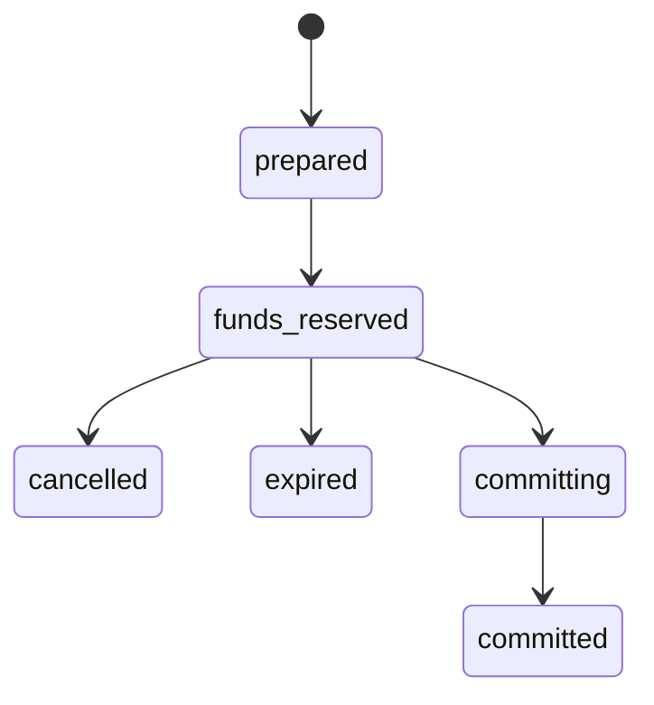
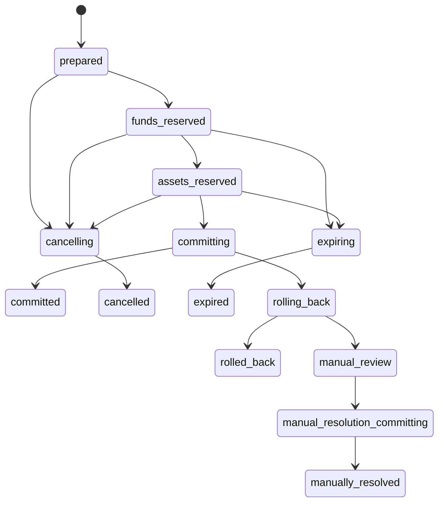

# Domain 10 Escrow Contract

## Purpose

This document defines the technical escrow contract for Domain 10.
It is the durable settlement foundation for:

- Auction House settlement;
- direct trade settlement when reserved custody is needed;
- `Fixed Price` service contracts;
- `Request for Offers`;
- player-to-player handoff flows involving money, materials, itemized currency,
  or service-input items.

It defines:

- escrow-eligible asset classes;
- the required durable record;
- reservation, commit, cancel, expiry, rollback, and manual-resolution
  semantics;
- replay, restart, and concurrency invariants;
- the split between service tender and customer-supplied operation fuel.

This is a contract document, not runtime proof and not a plugin-specific
implementation guide.

## Source Of Truth

Canonical authority:

- `docs/design/economy/escrow-contract.md`
- `docs/design/economy/economy-model.md`
- `docs/design/economy/currency-registry.yaml`
- `docs/design/economy/sources-and-sinks.yaml`
- `docs/design/economy/binding-policy.md`

Related upstream contracts:

- `docs/contracts/account-character-contract.yaml`
- `docs/contracts/reward-transaction-contract.yaml`
- `docs/contracts/economy-currency-contract.yaml`
- `docs/contracts/stack-lot-contract.yaml`
- `docs/design/items/itemization-framework.md`

## Authority Split

Domain 10 owns:

- escrow business semantics;
- fee and settlement behavior;
- escrow eligibility and release policy;
- business-state lifecycle;
- `manual_review` and manual-resolution triggers;
- economic outcomes of return, payout, and transformed-output delivery.

Domain 01 owns:

- durable transaction shell;
- `transaction_id`;
- `idempotency_key`;
- durable orchestration and replay semantics;
- revision or concurrency fencing primitives;
- durable receipt or equivalent audit layer.

Domain 02 owns:

- account and character identity boundaries;
- account-wide versus character-scoped custody primitives.

Domain 05 owns:

- item-instance identity;
- stack-lot or item-side durable identity primitives;
- item-side binding representation.

Domain 09 owns:

- service-process validity;
- whether a transformed output is valid;
- whether an output is bound or transferable by process rules.

## Escrow Scope

Escrow is required whenever the system needs temporary durable custody before a
player-visible outcome is final.

Escrow covers:

- reserving `gold` before payout, tax, fee, or refund;
- reserving eligible materials before service execution;
- reserving eligible itemized currency lots as customer-supplied operation fuel;
- reserving eligible service-input items before return or transformation;
- atomically releasing value to final ownership.

Escrow does not cover:

- premium balance;
- chat-only trust arrangements;
- preview-only flows with no durable value movement;
- any flow that cannot identify assets durably.

## Supported Escrow Types

- `market_listing_hold`
- `market_purchase_settlement`
- `direct_trade_settlement`
- `service_order_fixed_price`
- `service_order_rfo_acceptance`
- `service_order_refund`
- `service_order_return`
- `service_order_manual_resolution`

## Escrow Eligibility

The validator must resolve the asset to an exact category row in
`market-eligibility-matrix.yaml` before reserving custody. An asset is admitted
only if all are true:

1. Its category row exists and has a surface-appropriate `escrow` value.
2. It has durable identity.
3. Its binding state allows contract custody.
4. The release path is known in advance.
5. Retry and rollback can resolve ownership without invention.

Unknown categories, missing/invalid eligibility values, and unknown binding
states fail closed. They cannot be reserved, even when a caller claims a
service or manual-review exception.

Default eligibility:

| Asset class | Escrow eligible | Notes |
| --- | --- | --- |
| `gold` | yes | primary settlement tender |
| Premium balance | no | outside ordinary player economy |
| Unbound materials | yes | if the service flow supports them |
| Progression bottleneck materials | contract input only | matrix value is `input_only`; never a free-transfer deliverable |
| Itemized currency | yes | as stack-lot operation fuel, not as service tender |
| Unbound item instances | yes | if service-safe and durably identifiable |
| `character_bound` deliverable output | no for third-party transfer | valid only as final return to rightful owner |
| `service_locked` assets | yes inside owning contract only | never cross-contract portable |

Surface interpretation is fixed by the matrix:

- `escrow: allowed` admits general escrow, subject to the release path;
- `escrow: input_only` admits only as an input leg of the owning contract;
- `escrow: output_only` admits only as the output leg delivered to the rightful
  owner;
- `escrow: forbidden` and unknown values are rejected.

## Required Durable Record

Every escrow operation requires one durable record before irreversible mutation
begins.

Minimum escrow record:

```yaml
schema_version: 2
transaction_id:
transaction_type:
idempotency_key:
status:
created_at:
updated_at:
committed_at:
expires_at:
resolution_deadline_at:
failure_code:

initiator_account_id:
initiator_character_id:
counterparty_account_id:
counterparty_character_id:

party_roles:
  buyer:
    account_id:
    character_id:
  seller:
    account_id:
    character_id:
  customer:
    account_id:
    character_id:
  provider:
    account_id:
    character_id:

market_context:
  listing_id:
  order_id:
  offer_id:
  service_order_id:
  market_scope_id:

tender_entries:
  - leg_id:
    currency_id: gold
    source_account_id:
    source_character_id:
    reserved_amount:
    recipient_account_id:
    recipient_character_id:
    expected_revision:

operation_fuel_entries:
  - leg_id:
    currency_id:
    source_account_id:
    source_character_id:
    source_stack_lot_id:
    reserved_quantity:
    recipient_account_id:
    recipient_character_id:
    expected_revision:
    consumed_on_commit_only:
    remainder_stack_lot_id:
    lineage_event_ids: []

asset_lot_entries:
  - leg_id:
    asset_kind:
    asset_id:
    stack_lot_id:
    quantity:
    source_account_id:
    source_character_id:
    recipient_account_id:
    recipient_character_id:
    expected_revision:
    binding_snapshot:
    lineage_event_ids: []

fee_legs:
  - leg_id:
    fee_role: listing_fee|transaction_tax|service_fee
    currency_id: gold
    amount:
    payer_account_id:
    payer_character_id:
    recipient_account_id:
    charged_at_state:
    expected_revision:

metadata:
```

### Required field semantics

- `transaction_id`: globally unique durable identity.
- `transaction_type`: one approved escrow business flow type.
- `idempotency_key`: replay identity for the same business intent.
- `status`: current durable lifecycle state.
- `expires_at`: reservation expiry or listing-expiry timestamp when applicable.
- `resolution_deadline_at`: latest timestamp before unresolved custody must
  escalate.
- `party_roles`: canonical actor mapping so one record can express buyer,
  seller, customer, and provider cleanly. Each role is account-first and may
  include the initiating character; role omission is explicit for flows that do
  not use that party.
- `market_context`: stable listing, order, offer, service-order, and market
  scope IDs; display names or UI references are not valid substitutes.
- `tender_entries`: money legs used as settlement tender, normally `gold`.
  Every leg names its source, recipient, reserved amount, and expected account
  revision.
- `operation_fuel_entries`: itemized currency lots consumed as service or
  modification fuel, not paid out to the provider as tender unless a future
  contract explicitly says so. Every leg carries stack-lot identity, quantity,
  source/recipient participants, and an expected lot revision.
- `asset_lot_entries`: every reserved item, material lot, or output lot touched
  by settlement, with explicit quantity and source/recipient participants.
- `expected_revision`: concurrency fence for the exact mutable account, stack
  lot, or asset referenced by a leg; it is required on every reservable leg.
- `source_stack_lot_id`, `remainder_stack_lot_id`, and `lineage_event_ids` are
  required for stackable goods and itemized currency; quantity alone is not a
  sufficient custody reference.
- `fee_legs`: one row per fee charge with fee role, gold amount, payer,
  recipient/sink, charge state, and revision so retry and rollback can be
  audited per leg.

## Settlement Concepts

### Settlement tender

Settlement tender is the value paid as payment for the contract.

In v1:

- default service and market tender is `gold`;
- premium balance is forbidden;
- itemized currency is not default tender.

### Operation fuel

Operation fuel is a customer-supplied input consumed by the underlying process.

In v1:

- itemized currency may be operation fuel;
- operation fuel is reserved, consumed, returned, or partially returned
  according to process result;
- operation fuel is distinct from the provider's payment.

This resolves the earlier ambiguity:

- `gold` is what pays for the service;
- `currency items` may still be required to perform the service.

## Lifecycle States

Escrow uses this extended status vocabulary:

```yaml
- prepared
- funds_reserved
- assets_reserved
- committing
- committed
- cancelling
- cancelled
- expiring
- expired
- rolling_back
- rolled_back
- failed
- manual_review
- manual_resolution_committing
- manually_resolved
```

### State meanings

- `prepared`: durable record exists, no irreversible mutation yet.
- `funds_reserved`: tender funds fenced successfully.
- `assets_reserved`: required asset or fuel custody fenced successfully.
- `committing`: final ownership, fee, and release mutations are being applied.
- `committed`: final settlement durable and complete.
- `cancelling`: user or system-initiated cancellation is unwinding a still
  reversible reservation.
- `cancelled`: reservation was safely cancelled before final settlement.
- `expiring`: the contract passed a reservation or listing deadline and the
  system is unwinding it.
- `expired`: the contract expired and value was safely returned or released
  without commit.
- `rolling_back`: the system is reversing a failed or interrupted near-commit
  path.
- `rolled_back`: last safe pre-commit ownership was restored.
- `failed`: the operation ended before ambiguous custody existed.
- `manual_review`: automation cannot safely determine the right next action.
- `manual_resolution_committing`: an operator-approved resolution is being
  applied.
- `manually_resolved`: final durable result after human resolution.

## State Transitions

### Market listing lifecycle



### Service lifecycle



### Forbidden transitions

- `prepared -> committed` when custody was required.
- `committed -> rolled_back` as silent replay behavior.
- `manual_review` treated as terminal with no resolution path.
- any state transition inferred only from chat, GUI labels, or item lore.

## Reservation Model

### Fund reservation

Fund reservation means:

- the required `gold` amount is fenced at account scope;
- the same account balance cannot be spent by a competing operation;
- the reserved amount is not yet final payout or final fee removal.

### Asset reservation

Asset reservation means:

- item, material, or fuel lots are fenced;
- they cannot be relisted, retraded, or re-escrowed elsewhere;
- they become effectively `service_locked` while the contract is active.

### Stack-lot rules

When escrow touches itemized currency or stackable materials:

- reservation unit is a stack lot, not an abstract amount;
- partial reservation must create traceable remainder lots;
- cancellation or expiry must return exact residual quantity;
- commit must either consume or release exact lot quantities;
- merge and split events must be linked in the durable record.
- all split, merge, reserve, transfer, consume, and return events follow
  `docs/contracts/stack-lot-contract.yaml`; quantity mismatches block automatic
  settlement and enter `manual_review`.

## Listing Create, Cancel, And Expiry

### Listing create

- creates a durable escrow record;
- charges the upfront `listing_fee` immediately;
- reserves the listed asset or stack lot;
- moves to `funds_reserved` only if money reservation is needed for a special
  listing policy, otherwise may move straight to `assets_reserved`.

### Listing cancel

- may occur only before sale commit;
- releases reserved asset custody;
- does not refund the upfront listing fee unless a later policy explicitly says
  so;
- ends in `cancelled` or `manual_review`.

### Listing expiry

- occurs when `expires_at` passes;
- releases reserved asset custody;
- preserves already charged listing fee;
- ends in `expired` or `manual_review`.

## Settlement Outcomes

Every escrow flow must end in exactly one final business outcome:

1. `committed`
2. `cancelled`
3. `expired`
4. `rolled_back`
5. `failed`
6. `manually_resolved`

`manual_review` is not final.
It is a holding state awaiting human decision.

Forbidden outcomes:

- duplicate payout for the same `idempotency_key`;
- duplicate return of the same reserved lot;
- both transformed output and original input delivered as final state;
- hidden partial success masked as failure;
- cancellation or expiry without releasing reserved custody or escalating.

## Idempotency And Replay

Escrow is explicitly at-least-once safe, not exactly-once magical.

Rules:

- one business intent reuses one `idempotency_key`;
- a new user intent uses a new key;
- replay after `committed` returns the already committed outcome;
- replay after `cancelled`, `expired`, or `rolled_back` returns that known final
  outcome;
- replay during unresolved partial state resumes recovery or enters
  `manual_review`;
- replay must not double-charge listing, service, or settlement fees.

## Concurrency Rules

Escrow must fence against:

- spending the same `gold` balance twice;
- using the same item instance in two active contracts;
- using the same stack lot in two active reservations;
- racing one offer acceptance against another;
- relisting a reserved asset while it is already in custody.

Minimum concurrency fence inputs:

- `transaction_id`
- `idempotency_key`
- actor identity
- reserved asset or stack-lot identity
- expected revision
- listing, order, offer, or service-order identity

## Rollback Rules

Rollback returns the system to the last safe ownership state.
It does not invent a compromise state.

Rules:

- rollback returns reserved `gold` if settlement did not commit;
- rollback returns reserved materials and itemized fuel lots if they were not
  durably consumed by a valid committed process result;
- rollback returns original service-input item if no committed transform
  occurred;
- rollback must preserve fee-leg accounting and say whether a fee was charged,
  preserved, waived, or refunded;
- ambiguity escalates to `manual_review`.

## Manual Review And Manual Resolution

### `manual_review` triggers

- final ownership cannot be reconstructed safely;
- funds appear reserved but durable outcome is missing;
- transformed output exists but commit marker is contradictory;
- original input and transformed output both appear releasable;
- duplicate acceptances or duplicate payouts cannot be auto-resolved;
- provider/plugin state disagrees with durable transaction state;
- replay boundary is crossed with insufficient evidence for safe automation.

### `manual_resolution_committing`

This state exists so operator action is itself durably committed, not merely
noted in chat or external notes.

### `manually_resolved`

A manual resolution must still produce:

- one final ownership outcome;
- a complete fee breakdown;
- durable notes explaining the exception path.

## Service-Specific Rules

### `Fixed Price`

- customer agrees to known `gold` cost up front;
- `gold` tender reserves first;
- asset or fuel custody reserves second when needed;
- settlement pays provider, removes fees, and returns or delivers outputs
  atomically.

### `Request for Offers`

- publication does not require full tender reservation;
- a small anti-spam deposit may exist later as separate policy;
- full `gold` tender reservation occurs when a specific offer is accepted;
- from that point onward the contract behaves like ordinary service escrow.

### Service disputes

Escrow resolves economic correctness, not crafting disappointment.

Meaning:

- refund when the contract or execution path failed;
- no refund merely because RNG or a valid system result was unfavorable;
- custody ambiguity still triggers `manual_review`.

## Fee Handling

Escrow supports at least these fee classes:

- `listing_fee`
- `transaction_tax`
- `service_fee`

Rules:

- listing fee is charged upfront at listing creation;
- transaction tax is charged at successful sale settlement;
- service fee is charged at successful service settlement unless a later policy
  names a reservation or deposit variant;
- all fee legs must be represented explicitly in the durable record;
- retries must not re-charge already committed fee legs.

## Invariants

- `ESC-INV-001`: every escrow operation has a durable `transaction_id`.
- `ESC-INV-002`: every replay-safe business intent has an `idempotency_key`.
- `ESC-INV-003`: reserved funds must not be spent twice.
- `ESC-INV-004`: reserved assets and stack lots must not be delivered twice.
- `ESC-INV-005`: escrow may not identify assets by display name, lore, slot, or
  raw MMOItems type alone.
- `ESC-INV-006`: final commit and fee effects are atomic from the player's
  perspective.
- `ESC-INV-007`: rollback returns the last safe ownership state or escalates to
  `manual_review`.
- `ESC-INV-008`: tradeable input may become bound output if the upstream process
  validly says so.
- `ESC-INV-009`: premium balance is not valid tender for ordinary escrow flows.
- `ESC-INV-010`: one service input or stack lot may not be active in two escrow
  contracts at the same time.
- `ESC-INV-011`: `manual_review` is not terminal; every review case must end in
  `manually_resolved`, `rolled_back`, `cancelled`, `expired`, or `committed`.

## Non-Goals

- Exact plugin architecture.
- Exact database schema for the Domain 01 transaction coordinator.
- Final RFO reputation rules.
- Final fee percentages.
- Detailed crafting process steps owned by Domain 09.
