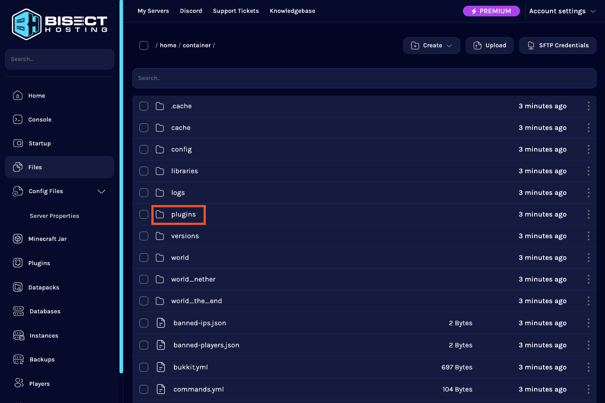
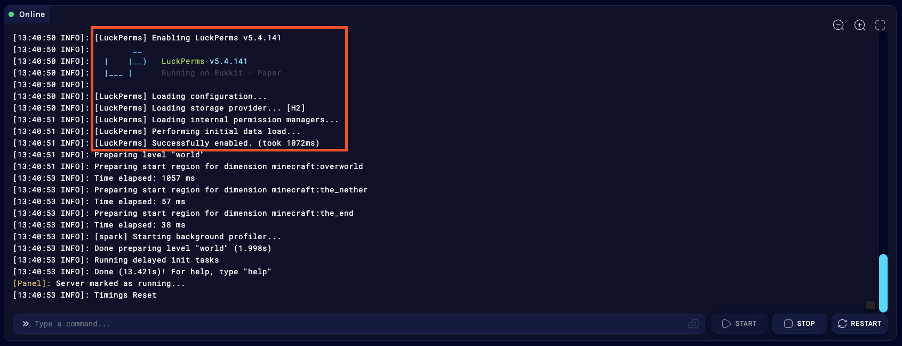
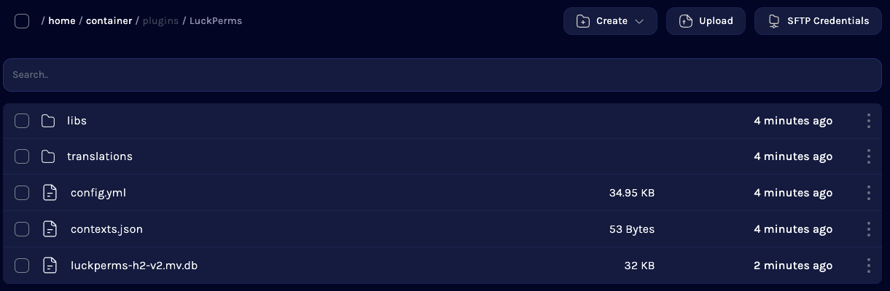

## Step 1: Download the LuckPerms jar file

The first thing you will need to do is download LuckPerms. You can always find the latest versions of LuckPerms for all of the platforms we support on our [downloads page](https://luckperms.net/download).

Just click the link to download and save the file somewhere easily accessible.

* If you are running a _non-modded_ server for Minecraft: Java Edition, we recommend that you use [Paper](https://papermc.io/) as your server.
* If you are running a _modded_ server for Minecraft: Java Edition, we recommend that you use [Fabric](https://fabricmc.net/) or [NeoForge](https://neoforged.net/) as your server.
* If you are running a server for Minecraft: Bedrock Edition, we recommend that you use [Nukkit](https://cloudburstmc.org/) as your server.
* If you are running a proxy to connect multiple Minecraft servers together, we recommend that you use [Velocity](https://velocitypowered.com/) or [Waterfall](https://papermc.io/downloads#Waterfall) (BungeeCord) as your proxy.
* If you are running a server for Hytale - you don't have much choice (currently)! The vanilla server is fine!

If you haven't got anywhere to host your server yet, check out our partner [BisectHosting](https://bisecthosting.com/luck), who offer LuckPerms users 25% off all of their game server hosting plans.

## Step 2: Add the LuckPerms jar to your server's `plugins` or `mods` folder

Next, we need to install LuckPerms onto the server. Make sure you have selected & installed the correct server jar, and that your server has successfully started at least once (this is to ensure the necessary folders will have been generated).

Navigate to your hosting panel's "File Manager", and open the `plugins` folder (for Bukkit, Paper, etc) or `mods` folder (for Forge, Fabric, Sponge or Hytale).

Once you're in the plugins or mods folder, click upload and when prompted, select the LuckPerms jar you downloaded in Step 1. Then click "Upload".

If you've installed an older version of LuckPerms before, make sure to delete any existing jar files.

## Step 3: Fully restart your server

Go to your server console and click "restart" or type `stop`.

When your server starts back up, LuckPerms will enable and generate the default configuration file. You should monitor the console to make sure LuckPerms starts up and enables correctly.

LuckPerms is now installed and you can start using it right away! Move onto the [Getting Started](Usage) section of the wiki for more information about what to do next!

## Step 4: Configure LuckPerms

To customize LuckPerms, you can make changes to its configuration file.

Go back to the "File Manager", then open the `plugins`/`mods` folder or `config` folder (for Sponge, Fabric or Forge). Then, open the `LuckPerms` folder within.

Here you will find a number of files. The important ones are:

* `config.yml` or `luckperms.conf` - this is the LuckPerms configuration file.
* `luckperms-h2-v2.mv.db` - this is the database file LuckPerms uses to store your permissions data (don't delete it!)

You can click on the `config.yml` or `luckperms.conf` files to view/edit them.

## Step 5 (optional): Setup LuckPerms to use a MySQL database or .yml files to store data

By default, LuckPerms stores all of it's data in a file-based database file called "H2". This is great because it's efficient and lets people start using LuckPerms without any extra config steps.

However, if you would prefer for LuckPerms data to be stored in **readable, editable .yml files**: open `config.yml`/`luckperms.conf`, scroll down to the "Storage Settings" section and set `storage-method` to `yaml`. Then restart your server.

If you run multiple servers in a network (or plan to do so in the future), then you will need to setup a remote database like **MySQL** for LuckPerms to store its data in.

Most server hosts provide these for free! Find the "Databases" menu, then click "Create database". If prompted, choose "MySQL" as the database type and input a sensible name.

After your database has been created, you should be presented with the following: a hostname, database name, username and password.

Once you have these details, take a note of them (or duplicate your tab), then navigate back to the LuckPerms `config.yml`/`luckperms.conf` file in the file manager and open it.

Scroll down to "Storage Settings" secton and set `storage-method` to `mysql`. Then fill out your database info under the `data:` section.

Click save, then restart your server.

You can then confirm in the console that MySQL has been setup correctly. If you see `Loading storage provider... [MYSQL]` followed by no errors, everything is working correctly!

Remember, you'll need to complete these steps for all servers you have in your network.

## FAQ
### Where do I install LuckPerms?
* If you run a network of servers, you should install LuckPerms into the plugin folder of every server you want to use LuckPerms on.
* If you also want to use LuckPerms to apply permissions on your Velocity/BungeeCord proxy, you should place LuckPerms-Velocity.jar or LuckPerms-Bungee.jar into your proxy plugins folder too.
* If you choose to only install LuckPerms on your proxy, it will have no impact on any permission checks performed by plugins on any backend servers. If you want that functionality, you need to install LuckPerms on those servers too.

### Can I just install LuckPerms on my proxy?
* The permissions system used on Velocity/BungeeCord is completely separate from the systems used on the backend server.
* You **can** just install it on the proxy, but any permission checks which are performed by backend Bukkit/Sponge plugins or Fabric/Forge mods will not be handled by LuckPerms.

## Requirements
LuckPerms has a few requirements. The *vast* majority of servers will meet these requirements already.

* You need Java 11 or higher
* Your server needs access to the internet the first time you load LuckPerms

---
### Java 11
Your server must be running **Java 11** or higher. LuckPerms does not work on older versions of Java.

Some platforms / Minecraft releases necessitate even new versions of Java (e.g. Java 21) which LuckPerms also supports.

---
### Internet Connection
LuckPerms uses a number of [external libraries](External-connections), some of which are [downloaded automatically at runtime](External-connections#downloading-libraries).

If your server does not have an internet connection, you can install LP locally (where you do have an internet connection), and then copy the content of the `/LuckPerms/libs/` directory to your other server.

## Compatibility
Some known compatibility issues are outlined below. In all cases, these issues are out of our control - and there's nothing we can do to resolve them in LuckPerms itself. 🙁

Some of the compatibility issues are resolved in newer releases of the server - but the fixes are not backdated.

### Other permission plugins
For LuckPerms to fully work & handle all permission checks, it must be the only permission plugin installed on your server (unless you want to perform automatic migration)!

---
### Older Minecraft versions
The main release of LuckPerms is not compatible with Minecraft: Java Edition versions earlier than 1.8.8.

A Bukkit LuckPerms release for 1.7.10 can be found on our [downloads page](https://luckperms.net/download/).
