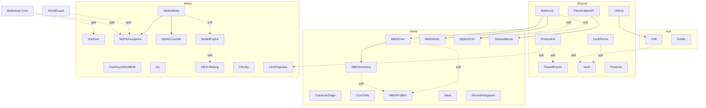

# Domain 16 Dependency Graph

contract_status: proposed
runtime_status: partially_verified
release_status: blocked
status_vocabulary_ref: docs/technical/status-and-evidence-vocabulary.md#canonical-status-and-evidence-rules

evidence_refs:
  - evidence_id: EVID-PLUGIN-MANIFEST-2026-08-12
    source_type: document
    source_path: docs/plugin_manifest.yaml
    observed_at: 2026-08-12
    scope: canonical plugin inventory and compact dependency notes
    summary: Repository-level manifest used as the single canonical plugin inventory input.
  - evidence_id: EVID-COMPAT-MATRIX-2026-06-24
    source_type: document
    source_path: docs/compatibility_matrix.md
    observed_at: 2026-06-24
    scope: staging-observed subset of plugin compatibility
    summary: Compatibility matrix confirms several MMO/Mythic/packet plugins on 1.21.11 staging.
  - evidence_id: EVID-BUILD-SERVERS-SPLIT-2026-07-22
    source_type: config
    source_path: MCMMORPG/docker/build-servers.sh
    observed_at: 2026-07-22
    scope: backend jar/data grouping rules for world, items and hub
    summary: Build script defines shared, world, items and hub plugin/data splits.

blockers:
  - blocker_id: BLK-DEPS-001
    status_family: release_status
    summary: Current repository does not expose a complete machine-readable source for depend, softdepend and loadbefore across every plugin jar.
    required_evidence: Plugin metadata extraction or vendor documentation for plugins still marked inferred/not proven.
    owner: domain-16
    scope: dependency-graph
  - blocker_id: BLK-DEPS-002
    status_family: runtime_status
    summary: Cross-plugin failure propagation is only partially proven by current repo docs and observed staging notes.
    required_evidence: Runtime logs or controlled startup evidence for dependency-failure scenarios.
    owner: domain-16
    scope: dependency-failure-points

## Reading Rules

- `proven` means directly supported by current repository inputs listed in `evidence_refs`.
- `inferred` means a plausible dependency used for review or sequencing, but not yet proven by a canonical metadata source.
- Missing dependency rows in the plugin manifest mean "not proven there", not "guaranteed none".
- This graph may include `inferred` working edges intentionally absent from the canonical plugin manifest because its compact dependency section records only repo-proven relationships.

## Dependency Classes

| Class | Meaning | Review action |
| --- | --- | --- |
| `hard` | Missing dependency should block plugin startup or expected core behavior. | Treat as startup-risk edge. |
| `soft` | Plugin can start, but specific features or bridges may degrade. | Treat as degraded-capability edge. |
| `split` | Backend assembly or runtime layout groups components together even without jar-level proof of plugin metadata. | Treat as packaging/runtime coupling. |
| `inferred` | Useful working assumption from naming, role, or known ecosystem, but not yet canonical. | Do not upgrade to release-proof without stronger evidence. |

## Core Graph

## Packaging And Load Surfaces

The current repo proves one important runtime split even where jar metadata is not yet canonical: `MCMMORPG/docker/build-servers.sh` groups jars and plugin data into `shared`, `world`, `items`, and `hub` backend packages.

| Surface | Proven by | Components |
| --- | --- | --- |
| `shared` jars | build script | `ProtocolLib`, `packetevents`, `PlaceholderAPI`, `Vault`, `LuckPerms`, `MythicLib`, `CMILib`, `PixelLibs` |
| `world` jars | build script | `FastAsyncWorldEdit`, `Iris`, `VoidGen`, `MythicDungeons`, `MythicMobs`, `MythicCrucible`, `ModelEngine`, `MEG-Molang`, `MCPets`, `Chunky`, `LibsDisguises` |
| `items` jars | build script | `CharacterStage`, `CoreTools`, `MMOCore`, `MMOItems`, `MMOInventory`, `MMOProfiles`, `MythicHUD`, `DeluxeMenus`, `nexo`, `DecentHolograms` |
| `hub` jars | build script | `CMI`, `Guilds`, `DecentHolograms` |

This split is a runtime packaging contract, not proof of official `depend`/`softdepend` declarations. `MCPets` remains in the build split as a legacy packaging input, but it is absent from the current `docs/plugin_manifest.yaml` inventory and from the active plugin directory.

## Plugin Edges

| From | To | Class | Basis | Notes |
| --- | --- | --- | --- | --- |
| `CMI` | `CMILib` | hard | proven | Build/runtime pairing and library naming strongly align; manifest baseline encodes it as proven. |
| `MMOCore` | `MythicLib` | hard | proven | Compatibility matrix says MythicLib is required for MMOCore/MMOItems. |
| `MMOItems` | `MythicLib` | hard | proven | Same matrix note as above. |
| `MMOInventory` | `MMOCore` | hard | inferred | Inventory/progression bridge naming and backend grouping support this, but no canonical jar metadata is stored yet. |
| `MMOProfiles` | `MMOCore` | soft | inferred | Profile bridge likely consumes MMO stack state; still needs canonical proof. |
| `MMOProfiles` | `MMOInventory` | soft | inferred | Same as above. |
| `MythicHUD` | `MythicLib` | soft | inferred | HUD/UI support in MMO stack suggests integration, but current proof is indirect. |
| `MythicHUD` | `PlaceholderAPI` | soft | inferred | Common bridge assumption; not yet proven from stored metadata. |
| `DeluxeMenus` | `PlaceholderAPI` | hard | inferred | Menu placeholder usage is likely, but still needs canonical proof. |
| `PacketEvents` | `ProtocolLib` | soft | proven | Compatibility matrix groups both as packet dependencies; build script packages both as shared. |
| `LibsDisguises` | `ProtocolLib` | soft | inferred | Ecosystem expectation, not yet canonical in this repo. |
| `Vault` | `LuckPerms` | soft | inferred | Permissions/economy bridge assumption from roles only. |
| `Vault` | `CMI` | soft | inferred | Legacy docs note CMI economy enabled with Vault provider; still not a canonical dependency declaration. |
| `MythicDungeons` | `MythicMobs` | hard | inferred | Naming and world split imply a close dependency, but repo proof is indirect. |
| `MythicCrucible` | `MythicMobs` | hard | inferred | Same as above. |
| `ModelEngine` | `MythicMobs` | soft | inferred | Runtime feature coupling is clear; jar-level dependency evidence is not yet stored. |
| `MEG-Molang` | `ModelEngine` | soft | inferred | Extension naming and packaging imply coupling. |
| `VoidGen` | `Multiverse-Core` | split | inferred | Build script proves co-packaging in the world slice, but not plugin dependency metadata. |
| `MythicDungeons` | `WorldGuard` | split | inferred | Runtime packaging groups them together, but current repo still lacks canonical dependency metadata. |
| `MythicDungeons` | `Multiverse-Core` | split | inferred | Same packaging/runtime coupling as above; not yet upgradeable to metadata-proof dependency semantics. |

## Failure Points

| Failure point | First break | Blast radius | Status |
| --- | --- | --- | --- |
| `CMILib` missing/incompatible | `CMI` admin/economy bridge | hub/admin surface and any Vault-bridged economy assumptions | partially verified |
| `MythicLib` missing/incompatible | `MMOCore`, `MMOItems` | classes, itemization, downstream MMO stack behavior | partially verified |
| `ProtocolLib` / `PacketEvents` drift | packet middleware | packet-facing integrations, anti-cheat surfaces, protocol bridges | partially verified |
| `MythicMobs` drift | world PvE stack | dungeons, mobs, model integrations, item asset hooks | partially verified |
| `ModelEngine` warnings or incompatibility | model/render path | creature models, model-based encounters, Molang extension path | partially verified |
| `LuckPerms` unavailable | permission authority | admin/control plane and Vault-related permission assumptions | partially verified |
| `HuskSync` remains disabled | player sync not active | release claims involving player-sync recoverability remain blocked | blocked |

## Review Notes

- The graph is intentionally conservative: only a small subset of hard/soft edges is marked `proven`.
- Release-facing dependency claims remain blocked until plugin metadata or vendor docs close `BLK-DEPS-001`.
- Downstream performance and architecture docs should reference this file for failure points, but not restate dependency semantics differently.
