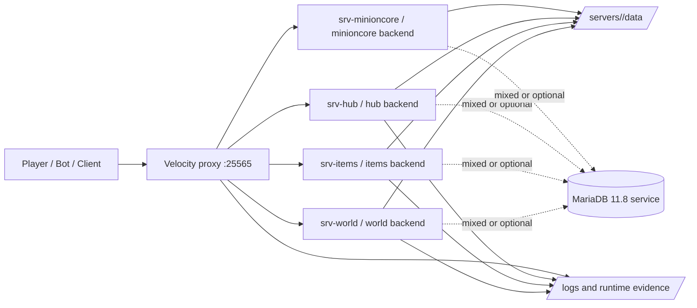

# Domain 16 Platform Architecture

contract_status: proposed
runtime_status: partially_verified
release_status: blocked
status_vocabulary_ref: docs/technical/status-and-evidence-vocabulary.md#canonical-status-and-evidence-rules

evidence_refs:
  - evidence_id: EVID-DOCKER-START-2026-07-22
    source_type: document
    source_path: MCMMORPG/START_HERE_DOCKER.md
    observed_at: 2026-07-22
    scope: operational description of docker plus velocity runtime
    summary: Runtime starts through Docker plus Velocity and documents world/items/hub style backends.
  - evidence_id: EVID-COMPOSE-2026-07-22
    source_type: config
    source_path: MCMMORPG/docker/compose.yml
    observed_at: 2026-07-22
    scope: proxy, database, backend containers, ports and volumes
    summary: Compose file defines MariaDB, Velocity, and backend containers on a shared network.
  - evidence_id: EVID-VELOCITY-CONFIG-2026-07-22
    source_type: config
    source_path: MCMMORPG/docker/velocity/velocity.toml
    observed_at: 2026-07-22
    scope: proxy bind, forwarding mode, backend targets, and fallback order
    summary: Velocity binds on 25565 and routes to world/items/hub/minioncore backends.
  - evidence_id: EVID-BUILD-SERVERS-2026-07-22
    source_type: config
    source_path: MCMMORPG/docker/build-servers.sh
    observed_at: 2026-07-22
    scope: backend assembly and plugin/data split
    summary: Build script creates self-contained backend `/data` directories from the live server tree.
  - evidence_id: EVID-SERVER-PROPERTIES-2026-07-22
    source_type: config
    source_path: MCMMORPG/server.properties
    observed_at: 2026-07-22
    scope: current Paper server network/runtime defaults
    summary: Current server.properties shows offline-mode baseline, RCON enabled, and staging-like defaults.
  - evidence_id: EVID-PLUGIN-MANIFEST-2026-08-12
    source_type: document
    source_path: docs/plugin_manifest.yaml
    observed_at: 2026-08-12
    scope: canonical plugin inventory input
    summary: The repository-level manifest is the single canonical plugin inventory.
  - evidence_id: EVID-DB-TOPOLOGY-2026-07-22
    source_type: document
    source_path: docs/technical/database-topology.md
    observed_at: 2026-07-22
    scope: mixed storage topology and active-vs-possible DB consumers
    summary: Database topology keeps MariaDB available as infrastructure, but active runtime still mixes local stores and unresolved DB consumers.

blockers:
  - blocker_id: BLK-ARCH-001
    status_family: release_status
    summary: Observed runtime still uses legacy backend names (`world`, `items`, `hub`) while target architecture decisions require semantics based on `staging-*` and `dev-*`.
    required_evidence: Explicit cutover or mapping plan from legacy names to target environment semantics.
    owner: domain-16
    scope: runtime-topology
  - blocker_id: BLK-ARCH-002
    status_family: runtime_status
    summary: Current repository does not yet prove all companion bridge, cache, and minioncore relationships from a single canonical runtime map.
    required_evidence: Architecture or runtime evidence for additional bridge/cache surfaces beyond compose and build script.
    owner: domain-16
    scope: auxiliary-runtime-surfaces

## Architecture Stance

This document separates:

- observed runtime layout: what the current repo and docker stack prove today
- target environment semantics: what Domain 16 architecture decisions already require for durable runtime governance

Observed legacy names are not treated as the target ownership model.
They are historical/runtime evidence only and are not an instruction to select,
start, or modify those backends. New work must follow the current repository
instructions and the target `staging` / `dev-*` environment contract.

## Runtime Overview

## Observed Runtime Topology

| Layer | Observed component | Proven by | Notes |
| --- | --- | --- | --- |
| Entry proxy | `velocity` container on `0.0.0.0:25565` | compose + velocity.toml | Single public entrypoint for local docker runtime. |
| Backend game server | `srv-world` | compose + velocity.toml + build script | World/dungeon/mob/model-heavy runtime slice. |
| Backend progression server | `srv-items` | compose + velocity.toml + build script | Character, MMO stack, UI/menu heavy runtime slice. |
| Backend social server | `srv-hub` | compose + velocity.toml + build script | Social/admin-facing slice with CMI/Guilds style packaging. |
| Auxiliary backend | `srv-minioncore` | velocity.toml | Referenced by proxy config; not part of the current foundation scope. |
| Database service | `mariadb:11.8` | compose | Shared MariaDB service exists, but active backend consumers remain only partially proven in DB topology. |
| Backend data roots | `MCMMORPG/docker/servers/<backend>` | compose + build script | Self-contained `/data` directories built from live repo state. |
| Runtime source tree | `MCMMORPG/` | repo layout | Holds paper jar, config, plugins, logs, worlds, disabled blockers, and validation helpers. |

## Target Environment Semantics

Architecture decisions already establish the preferred semantics:

- `staging` is a runtime role, not an old area name
- `dev-*` backends are disposable, scope-based sandboxes
- `world/items/hub` are legacy runtime naming surfaces and must not be treated as the long-term ownership taxonomy
- content config is versioned source; worlds, databases, caches, and logs are runtime state

This means the current docker runtime is observed legacy-shaped infrastructure under a stricter target governance model.

## Traffic And Session Flow

| Step | Observed flow | Evidence |
| --- | --- | --- |
| 1 | Client connects to Velocity on port `25565`. | velocity.toml |
| 2 | Velocity uses modern forwarding and a shared secret with assembled Paper config. | velocity.toml + build-servers.sh |
| 3 | Velocity tries backends in configured order, currently `items`, then `world`, then `hub`. | velocity.toml |
| 4 | Backend containers expose Paper on internal port `25565` and optional companion bridge ports on localhost bindings. | compose.yml |
| 5 | Backends always use assembled `/data` trees; some slices may also use shared MariaDB or plugin-local stores depending on plugin cutover state. | compose.yml + build-servers.sh + database-topology.md |

## Runtime Components

| Component | Owner | Source of truth | Failure mode | Evidence surface |
| --- | --- | --- | --- | --- |
| Velocity proxy config | domain-16 | `MCMMORPG/docker/velocity/velocity.toml` | Clients cannot route or forwarding breaks | config + proxy logs |
| Backend packaging split | domain-16 | `MCMMORPG/docker/build-servers.sh` | Wrong plugins/data land in wrong backend | build script + resulting `/servers/*` trees |
| Docker topology | domain-16 | `MCMMORPG/docker/compose.yml` | Containers cannot reach DB/proxy/backend targets | compose config + container runtime |
| Paper runtime defaults | domain-16 | `MCMMORPG/server.properties` plus assembled Paper config | Session/bootstrap behavior diverges from expected baseline | config + startup logs |
| Plugin inventory | domain-16 | `docs/plugin_manifest.yaml` | Plugin drift or missing inventory authority | canonical document + plugin directory inventory |
| MariaDB service | domain-16 | compose config + DB topology doc | Only MariaDB-dependent slices degrade or fail; mixed local-store plugins may continue separately | DB healthcheck + runtime evidence |
| Disabled runtime blockers | domain-16 | `MCMMORPG/disabled-runtime-blockers/` | Release claims ignore intentionally disabled components | inventory + blocker notes |

## Storage Boundaries

| Surface | Classification | Current evidence | Notes |
| --- | --- | --- | --- |
| `MCMMORPG/docker/servers/<backend>/...` | backend runtime state | compose + build script | Self-contained `/data` trees for each backend. |
| `MCMMORPG/world*` | world runtime state | repo layout | World data is runtime, not design source-of-truth. |
| `mariadb_data` volume | durable DB runtime state | compose | Shared persistent DB volume. |
| `MCMMORPG/plugins/` | versioned runtime input | repo layout + plugin baseline | Source inventory for backend assembly. |
| `MCMMORPG/logs/` | observability/evidence source | repo layout + current server plan | Needed for runtime and release evidence. |
| `MCMMORPG/cache/` | runtime auxiliary state | repo layout only | Exact cache contract remains future-ticket territory. |

## Observability Surfaces

This foundation ticket does not define budgets or alerts, but it does pin where evidence comes from:

| Surface | What it gives | Status |
| --- | --- | --- |
| `MCMMORPG/logs/latest.log` | startup/runtime warnings and plugin errors | proven |
| docker container state/logs | proxy/backend/container health | proven |
| `docs/audits/2026-07-13/runtime-evidence-register.yaml` | current runtime findings registry | proven |
| plugin inventory docs | baseline expected stack | proven |
| metrics/alerts pipeline | sustained performance or alerting proof | not yet proven |

## Failure Points

| Failure point | First break | Blast radius | Status |
| --- | --- | --- | --- |
| Velocity misrouting or bad forwarding secret | login/session routing | all backends behind proxy | partially verified |
| MariaDB unavailable | MariaDB-dependent persistence paths | only slices already cut over to shared DB plus shared recovery workflows | partially verified |
| Wrong backend assembly in `build-servers.sh` | plugin/data mismatch | one or more backend runtime slices | not_verified |
| Legacy naming treated as final architecture | ownership and release confusion | architecture, deployment, and QA docs drift | blocked |

## Review Notes

- `world/items/hub` are still important observed runtime names because compose and build scripts use them today.
- They are not promoted here as the target domain or release taxonomy.
- Shared MariaDB is modeled here as an available infrastructure surface, not proof that every backend in the observed runtime actively depends on it today.
- The next docs in this chain should consume:
  - dependency failure points from `docs/technical/dependency-graph.md`
  - canonical status rules from `docs/technical/status-and-evidence-vocabulary.md`
  - plugin inventory from `docs/plugin_manifest.yaml`
