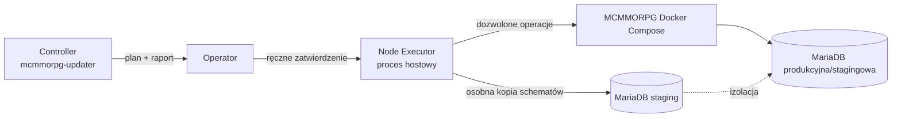

# Plan wdrożenia: niezależny controller aktualizacji MCMMORPG

## Cel

Zbudować osobny projekt `mcmmorpg-updater`, działający na tym samym hoście co
Dockerowy stack MCMMORPG. Controller wykrywa i przygotowuje aktualizacje,
generuje audytowalny plan i czeka na ręczne zatwierdzenie. Ograniczony Node
Executor wykonuje wyłącznie operacje z zatwierdzonego planu; nie udostępnia
dowolnego shella ani `docker.sock` kontenerowi.

## Ustalona architektura

- `mcmmorpg-updater/` jest osobnym projektem: `compose.yml`, `config/`,
  `registry/`, `data/`, `downloads/`, `staging/`, `backups/`, `reports/`.
- Registry opisuje plugin na poziomie targetu, nie globalnie. Targety: `world`,
  `items`, `hub`, `velocity`; każdy ma compose project/service/profile, ścieżkę
  danych hosta i ścieżkę danych kontenera.
- Executor przyjmuje tylko: `inventory`, `backup`, `prepare-staging`,
  `compose-stop`, `compose-start`, `compose-run-test`, `health-check`,
  `deploy`, `rollback`. Każda operacja jest powiązana z konkretnym,
  zatwierdzonym planem i targetem.
- Test aktualizacji uruchamia kopię danych serwera z **oddzielnym** kontenerem
  `mcmmorpg-mariadb-staging` i tylko sklonowanymi, wymaganymi schematami.
  Kontener testowy nie może mieć sieciowej ani konfiguracyjnej ścieżki do
  współdzielonej MariaDB.
- Deploy nie używa `/reload`: pobranie i walidacja JAR-a, kopia zapasowa,
  staging, kontrolowany stop, atomowa podmiana, start i health check;
  niepowodzenie uruchamia rollback.

## Polityka pilotażu zatwierdzona po krytyce bezpieczeństwa

- Pierwszy pilotaż obejmuje wyłącznie jeden backend `world`, `items` lub `hub`;
  `velocity` jest wyłączony z pilotażu i wymaga później osobnego globalnego
  maintenance window.
- Pilot dopuszcza wyłącznie plugin sklasyfikowany jako `none` dla zmian DB oraz
  z jawną, odtwarzalną listą mutowalnych plików `/data`.
- Aktualizacja `backward-compatible` wymaga przed produkcją dowodu uruchomienia
  starego JAR-a na post-migration staging DB. `irreversible` jest blokowane z
  automatycznego deployu i wymaga osobnego planu roll-forward oraz okna
  utrzymaniowego.
- Zatwierdzenie to root-owned, jednokrotny rekord z plan hash, TTL i nonce;
  nie sam hash. Executor pobiera service/rooty z własnego registry, stosuje
  per-target lock i ponownie weryfikuje aktualny stan przed zapisem.
- Staging ma unikalną tożsamość Compose, prywatną sieć `internal`, własne
  wolumeny i krótkotrwałe credentials. Jednorazowy eksport danych ma oddzielne,
  zakresowe konto read-only; backend stagingowy nigdy go nie otrzymuje.
- Registry zawiera wersjonowaną politykę mutacji `/data` per plugin/target:
  wyłącznie kanoniczne ścieżki pod rootem targetu, klasa `rollback` albo
  `excluded`, mechanizm backupu/restore i hash manifestu. Światy oraz dane
  graczy są `excluded`. Niezadeklarowana mutacja jest błędem fail-closed.

## Kolejność prac

### Faza 0 — kontrakt i granice bezpieczeństwa

#### Zadanie 1: Zdefiniować kontrakt planu aktualizacji i zatwierdzenia

**Opis:** Określić wersjonowany format planu (JSON/YAML), jego identyfikator,
stan, hash, listę targetów, artefakty i oczekiwane walidacje. Zatwierdzenie ma
być root-owned, podpisanym lub MAC-owanym rekordem z TTL, nonce i stanem
jednokrotnego użycia; executor ma odrzucać replay, zmianę planu i równoległe
wykonanie targetu.

**Kryteria odbioru:**

- [ ] Plan wskazuje dokładne obecne i kandydackie JAR-y, SHA-256, źródło,
  targety oraz sekwencję dozwolonych operacji.
- [ ] Zatwierdzenie jest audytowalne: operator, czas, identyfikator i hash
  planu są w raporcie.
- [ ] Nie można wykonać planu niezatwierdzonego, zmienionego ani spoza
  dozwolonego schematu.
- [ ] Executor czerpie service/profile/rooty z własnego registry, nie z planu,
  i blokuje target na czas wykonania.

**Weryfikacja:** testy walidatora kontraktu dla planu poprawnego,
niezatwierdzonego i z niezgodnym hashem oraz spoofingu approval, replay, TTL,
nonce i konkurencyjnego planu.

**Zależności:** Brak.

**Przewidywane pliki:** `mcmmorpg-updater/config/plan-schema.*`,
`mcmmorpg-updater/config/operation-policy.*`, testy kontraktu.

**Zakres:** M.

#### Zadanie 2: Zdefiniować izolację i politykę danych MariaDB dla stagingu

**Opis:** Dla każdego pluginu z dostępem SQL określić bazę/schemat/tabele,
klasyfikację (`none`, `backward-compatible`, `irreversible`), metodę kopii,
dane wrażliwe i retencję. Utworzyć unikalny projekt Compose stagingu z osobnym
wolumenem, siecią `internal`, krótkotrwałymi credentials i oddzielonym,
read-only eksporterem danych.

**Kryteria odbioru:**

- [ ] Testowy backend rozwiązuje DB host wyłącznie do stagingowej MariaDB.
- [ ] Kopia obejmuje tylko zarejestrowane schematy/tabele wymagane przez target.
- [ ] Raport wykazuje źródło snapshotu, zakres danych i rezultat kontroli braku
  połączenia z produkcyjną bazą.
- [ ] Plan określa restore albo roll-forward-only; pełny restore współdzielonej
  MariaDB podczas pracy innych backendów jest zabroniony.

**Weryfikacja:** `docker compose config` i runtime `docker inspect` dla
project labels, sieci, mountów, wolumenów i credentials; test połączeń z
kontenera testowego oraz próba DNS/IP do produkcyjnej bazy, która musi być
odrzucona.

**Zależności:** Zadanie 1.

**Przewidywane pliki:** `mcmmorpg-updater/compose.yml`,
`mcmmorpg-updater/config/database-policy.*`,
`mcmmorpg-updater/scripts/clone-schema.*`.

**Zakres:** M.

### Checkpoint: granice wykonania

- [ ] Kontrakt zatwierdzenia i izolacja SQL mają niezależne testy negatywne.
- [ ] Nie istnieje ścieżka z kontenera stagingowego do `mcmmorpg-mariadb`.
- [ ] Staging ma odrębną runtime-zweryfikowaną tożsamość projektu, sieci,
  wolumenów i credentials.
- [ ] Przegląd człowieka potwierdza zakres kopiowanych danych i retencję backupów.

### Faza 1 — inventory i registry targetów

#### Zadanie 3: Utworzyć registry targetów i instalacji pluginów

**Opis:** Wprowadzić registry z deklaracjami `world`, `items`, `hub`,
`velocity` oraz instalacjami pluginów per target. Registry zawiera dokładny
service ID, profile, digest configu Compose, dozwolony lifecycle i blast-radius
class; `velocity` ma `pilot_eligible: false`. Zachować manifest pluginów jako
źródło obserwowanego baseline'u.

**Kryteria odbioru:**

- [ ] Każdy target zawiera project, service, opcjonalny profile oraz hostową i
  kontenerową ścieżkę danych.
- [ ] Ten sam plugin może mieć niezależną wersję, konfigurację i politykę dla
  wielu targetów.
- [ ] Walidator odrzuca nieistniejący service, ścieżkę poza dozwolonym rootem
  lub wpis bez targetu.
- [ ] Wykonanie backendu może dotknąć tylko jednego service bez dependencies ani
  recreate, a target Velocity nie kwalifikuje się do pilotażu.
- [ ] Każda instalacja pluginu ma wersjonowaną politykę mutacji `/data` per
  target: kanoniczną ścieżkę, klasę `rollback`/`excluded` i procedurę restore;
  światy oraz dane graczy są zawsze `excluded`.

**Weryfikacja:** testy schematu registry i porównanie service/profile z
`MCMMORPG/docker/compose.yml`.

**Zależności:** Zadanie 1.

**Przewidywane pliki:** `mcmmorpg-updater/registry/targets.yaml`,
`mcmmorpg-updater/registry/plugins.yaml`, testy registry.

**Zakres:** M.

#### Zadanie 4: Zbudować inwentaryzację lokalnych JAR-ów i konfiguracji

**Opis:** Skanować każdy target, wyliczać SHA-256, wykrywać JAR-y i istotne
konfiguracje, a wyniki zapisywać jako immutable snapshot do `data/` oraz raport
do `reports/`.

**Kryteria odbioru:**

- [ ] Inventory identyfikuje JAR i wersję per target, nie tylko per nazwa
  pluginu.
- [ ] Snapshot zawiera hash, rozmiar, ścieżkę i czas skanu.
- [ ] Skan jest tylko do odczytu i ignoruje sekrety oraz dane graczy.

**Weryfikacja:** test fixture z rozbieżną wersją pluginu na dwóch targetach i
kontrola SHA-256.

**Zależności:** Zadanie 3.

**Przewidywane pliki:** `mcmmorpg-updater/src/inventory/*`,
`mcmmorpg-updater/data/`, testy inventory.

**Zakres:** M.

#### Zadanie 5: Dodać pobieranie kandydatów i walidację metadanych JAR

**Opis:** Pobierać kandydatów do `downloads/`, nigdy bezpośrednio do katalogu
serwera; używać zaufanych adapterów z pinowanym HTTPS host/project, ograniczać
redirecty, DNS/IP, rozmiar i format JAR. Weryfikować niezależny podpis lub
checksumę upstream; bez niej wymagać ręcznej aprobaty konkretnego hasha.

**Kryteria odbioru:**

- [ ] Niezweryfikowany JAR nie może zostać dodany do planu aktualizacji.
- [ ] Niezgodność `plugin.yml` z oczekiwaną nazwą pluginu jest błędem blokującym.
- [ ] Raport podaje URL/identyfikator źródła, hash i wynik walidacji.
- [ ] SSRF, cross-host redirect, oversized/zip-bomb JAR i zduplikowane
  `plugin.yml` są blokowane.

**Weryfikacja:** fixture poprawnego JAR-a oraz testy błędnej nazwy, checksumy i
niedozwolonego źródła.

**Zależności:** Zadania 3–4.

**Przewidywane pliki:** `mcmmorpg-updater/src/downloads/*`,
`mcmmorpg-updater/config/source-policy.*`, testy walidacji JAR.

**Zakres:** M.

### Checkpoint: wiarygodny plan aktualizacji

- [ ] Inventory, registry i walidacja pobrania tworzą plan dla jednego pluginu
  na jednym backendzie.
- [ ] Plan nie może przejść do zatwierdzenia z brakującym hashem lub metadanymi.
- [ ] Raport wskazuje różnice per target.

### Faza 2 — ograniczony executor i staging

#### Zadanie 6: Zaimplementować allowlistę Node Executora i autoryzację planu

**Opis:** Udostępnić mały proces hostowy, który mapuje dziewięć deklarowanych
operacji na parametryzowane wywołania. Ma stosować root-owned registry,
no-follow/dirfd semantics dla plików, per-target lock, rewalidację hashów tuż
przed zapisem i brak interpretacji shellowych argumentów od controllera.

**Kryteria odbioru:**

- [ ] Executor przyjmuje wyłącznie operacje i targety obecne w polityce oraz
  zatwierdzonym planie.
- [ ] Wstrzyknięte argumenty, `..`, dodatkowy service i nieznana operacja są
  odrzucane.
- [ ] Każde wywołanie zapisuje korelowany log operacji i kod zakończenia.
- [ ] Symlink/hardlink escape, TOCTOU i replay planu są odrzucane.

**Weryfikacja:** testy allowlisty, spoofingu approval, symlink/hardlink escape,
TOCTOU, konkurencji i mock warstwy Compose.

**Zależności:** Zadania 1 i 3.

**Przewidywane pliki:** `mcmmorpg-updater/executor/*`,
`mcmmorpg-updater/config/operation-policy.*`, testy executora.

**Zakres:** M.

#### Zadanie 7: Dodać backup i przygotowanie stagingu danych serwera

**Opis:** Tworzyć wersjonowaną kopię `plugins/` oraz jawnej listy mutowalnych
konfiguracji przed testem i deployem; z niej tworzyć stagingowy katalog serwera
bez modyfikowania danych aktywnego backendu. Światy i dane graczy są domyślnie
wyłączone, dopóki polityka pluginu nie określi ich bezpiecznego odtworzenia.

**Kryteria odbioru:**

- [ ] Backup zawiera manifest plików i SHA-256 oraz da się odtworzyć do pustego
  katalogu testowego.
- [ ] `prepare-staging` nie zmienia katalogu aktywnego targetu.
- [ ] Backup nie trafia do kontroli wersji i ma zdefiniowaną retencję.
- [ ] `prepare-staging` odrzuca path poza kanoniczną polityką oraz tworzy
  manifest before/after; każda ścieżka klasy `rollback` ma test restore.

**Weryfikacja:** fixture katalogu targetu, porównanie hashy przed/po oraz test
odtworzenia.

**Zależności:** Zadania 2 i 6.

**Przewidywane pliki:** `mcmmorpg-updater/src/backups/*`,
`mcmmorpg-updater/src/staging/*`, konfiguracja ignorowania danych, testy.

**Zakres:** M.

#### Zadanie 8: Uruchomić testowy backend z izolowaną bazą i analizą logu

**Opis:** Startować kopię tylko wskazanego backendu na stagingowych danych,
unikalnym projekcie, odizolowanej sieci i stagingowej MariaDB. Przepisywać lub
odrzucać DSN i sekrety produkcyjne w kopii `/data`; po starcie analizować pełny
`latest.log`. Dla `backward-compatible` testować stary JAR na post-migration DB.

**Kryteria odbioru:**

- [ ] Staging używa tylko testowego katalogu i testowej MariaDB.
- [ ] Timeout, crash lub błąd ładowania pluginu kończy test jako blokujący.
- [ ] Pełny log i wynik analizy są dołączone do raportu planu.
- [ ] `docker inspect` dowodzi, że project labels, mounts, network IDs, volume
  IDs i credentials nie należą do produkcji.
- [ ] Manifest before/after odrzuca każdą mutację `/data` poza polityką i
  dostarcza dowód restore ścieżek klasy `rollback`.

**Weryfikacja:** test Compose z fixture; wymuszony błąd pluginu musi zablokować
deploy, a poprawny start dostarczyć raport.

**Zależności:** Zadania 5–7.

**Przewidywane pliki:** `mcmmorpg-updater/compose.yml`,
`mcmmorpg-updater/src/staging/run-test.*`,
`mcmmorpg-updater/src/log-analysis/*`, testy integracyjne.

**Zakres:** M.

### Checkpoint: staging bez wpływu na aktywny backend

- [ ] Wymuszona migracja/zmiana danych pozostaje w stagingowej MariaDB.
- [ ] Niezdany staging uniemożliwia deploy.
- [ ] Odtworzenie z backupu przechodzi w kontrolowanym fixture.

### Faza 3 — deploy, odzyskanie i audyt

#### Zadanie 9: Zaimplementować bezpieczny deploy atomowy jednego targetu

**Opis:** Dla zatwierdzonego i pozytywnie przetestowanego planu odłączyć backend
od ruchu Velocity, opróżnić sesje, zatrzymać tylko wskazany backend i zachować
backup. Skopiować kandydat do `.next` w tym samym filesystemie, fsyncować plik
i katalog, wykonać rename oraz uruchomić backend. Pierwszy pilotaż nie obejmuje
Velocity ani pluginów innych niż DB class `none`.

**Kryteria odbioru:**

- [ ] Brak `/reload` i brak podmiany pliku podczas pracy procesu backendu.
- [ ] Nieudana podmiana lub start nie pozostawia częściowo wdrożonego JAR-a.
- [ ] Operacja dotyka tylko zatwierdzonego service i zarejestrowanego katalogu.
- [ ] Trwały journal i idempotentne kroki pozwalają po awarii procesu odzyskać
  stan początkowy lub zgłosić `recovery-required`.
- [ ] Deploy odrzuca plan bez polityki mutacji; manifest before/after obejmuje
  każdą ścieżkę `rollback`, a `excluded` nigdy nie jest kopiowane ani odtwarzane.

**Weryfikacja:** testy filesystemu dla fsync/rename/awarii i kill procesu po
każdym kroku oraz mock Compose potwierdzający pojedynczy service bez recreate.

**Zależności:** Zadania 6–8.

**Przewidywane pliki:** `mcmmorpg-updater/src/deploy/*`, testy deployu.

**Zakres:** M.

#### Zadanie 10: Dodać health check i deterministyczny rollback

**Opis:** Po deployu sprawdzać boot log, dostępność RCON i portu z określonym
czasem rozruchu oraz plugin-specific readiness (nazwa/wersja, brak fatal errors,
wymagane komendy/canary DB). Ruch wraca dopiero po walidacji. Przy niepowodzeniu
przywracać dozwolony zakres plików i poprzedni JAR, restartować target oraz
zapisywać rezultat odzyskania.

**Kryteria odbioru:**

- [ ] Health check ma skonfigurowane grace period i timeout per target.
- [ ] Nieudany health check uruchamia rollback bez interwencji operatora.
- [ ] Raport rozróżnia: deploy OK, deploy nieudany ale rollback OK, rollback
  nieudany.
- [ ] Dla aktualizacji DB class `none` potwierdzony jest brak nieobjętych
  polityką mutacji `/data`; pozostałe klasy nie uruchamiają automatycznego
  restore bez jawnej strategii.
- [ ] Rollback odtwarza i weryfikuje każdą ścieżkę klasy `rollback`; różnica
  poza manifestem kończy operację statusem `recovery-required`.

**Weryfikacja:** scenariusze testowe sukcesu, timeoutu RCON, błędu boot logu i
błędu rollbacku.

**Zależności:** Zadanie 9.

**Przewidywane pliki:** `mcmmorpg-updater/src/health/*`,
`mcmmorpg-updater/src/rollback/*`, testy odzyskiwania.

**Zakres:** M.

#### Zadanie 11: Wygenerować raport końcowy i przeprowadzić pilotaż

**Opis:** Skonsolidować inventory, źródła, walidacje, zatwierdzenie, staging,
deploy, health check i rollback w jeden raport. Przeprowadzić pilotaż na jednym
niekrytycznym pluginie DB class `none` na jednym backendie bez Velocity i
udokumentować runbook operatora z maintenance fallback.

**Kryteria odbioru:**

- [ ] Raport jest wystarczający do audytu decyzji bez odczytywania surowych
logów, a pełne logi są załączonymi artefaktami.
- [ ] Pilotaż obejmuje szczęśliwą ścieżkę oraz kontrolowany rollback.
- [ ] Runbook zawiera warunki zatwierdzenia, zakaz `/reload` i procedurę awarii.
- [ ] Pilotaż potwierdza traffic gate, journal recovery oraz brak mutacji DB i
  plików poza zadeklarowanym zakresem.

**Weryfikacja:** ręczny przegląd raportu pilotażowego oraz test end-to-end na
fixture/wybranym stagingowym pluginie.

**Zależności:** Zadanie 10.

**Przewidywane pliki:** `mcmmorpg-updater/reports/*`,
`mcmmorpg-updater/docs/operator-runbook.md`, test E2E.

**Zakres:** M.

### Checkpoint: gotowość do użycia

- [ ] Jeden plugin na jednym backendzie przechodzi pełny cykl: inventory →
  kandydat → zatwierdzenie → izolowany staging → deploy → health check.
- [ ] Kontrolowany błąd kończy się potwierdzonym rollbackiem.
- [ ] Operator akceptuje raport i runbook przed rozszerzeniem na kolejne targety.

## Ryzyka i ograniczenia

| Ryzyko | Skutek | Ograniczenie |
| --- | --- | --- |
| Plugin wykona migrację SQL podczas testu | Uszkodzenie danych aktywnych | Odseparowana MariaDB, prywatna sieć i jawna polityka kopiowania schematów |
| Controller uzyska możliwość dowolnego wykonania | Przejęcie hosta | Hostowy executor z allowlistą, kontrakt planu i brak pola shell command |
| Błędny JAR lub zależność | Niedostępny backend | Weryfikacja `plugin.yml`, hashów, staging i automatyczny rollback |
| RCON/log daje fałszywy negatyw podczas bootu | Niepotrzebny rollback | Grace period, wiele sygnałów health i archiwum pełnego logu |
| Podmiana aktywnego pliku | Niespójna instalacja | Stop konkretnego backendu + atomic rename + backup |
| Współdzielone pliki/DB między targetami | Nieoczekiwany wpływ boczny | Registry per target oraz wąskie ścieżki i schematy |

## Otwarte decyzje wymagające potwierdzenia

1. Jaki jest autorytatywny mechanizm uzyskania kopii danych SQL do stagingu:
   logical dump per schema, storage snapshot, czy zanonimizowany seed? Decyzja
   determinuje prywatność, czas oraz możliwość testowania migracji.
2. Czy staging ma testować prawdziwe dane graczy po anonimizacji, czy tylko
   kontraktowe/selektywne dane testowe? Nie wolno przyjąć tego domyślnie.
3. Które rejestry źródeł są dozwolone dla automatycznego pobierania (wyłącznie
   vendor API/release, czy także ręcznie dostarczony URL z checksumą)?
4. Czy executor ma być lokalnym CLI/daemonem pod dedykowanym użytkownikiem, czy
   usługą z lokalnym API? Plan zakłada ten pierwszy wariant jako mniejszą
   powierzchnię ataku, dopóki nie ma potrzeby zdalnego interfejsu.
5. Jaka jest retencja `backups/`, `downloads/`, `staging/` i `reports/`, oraz
   gdzie mają być przechowywane szyfrowane kopie długoterminowe?

## Warunki rozpoczęcia implementacji

- [ ] Potwierdzone odpowiedzi na pięć otwartych decyzji.
- [ ] Przegląd i akceptacja kolejności zadań.
- [ ] Pilot wskazany jako konkretny plugin i target o niskim wpływie.
